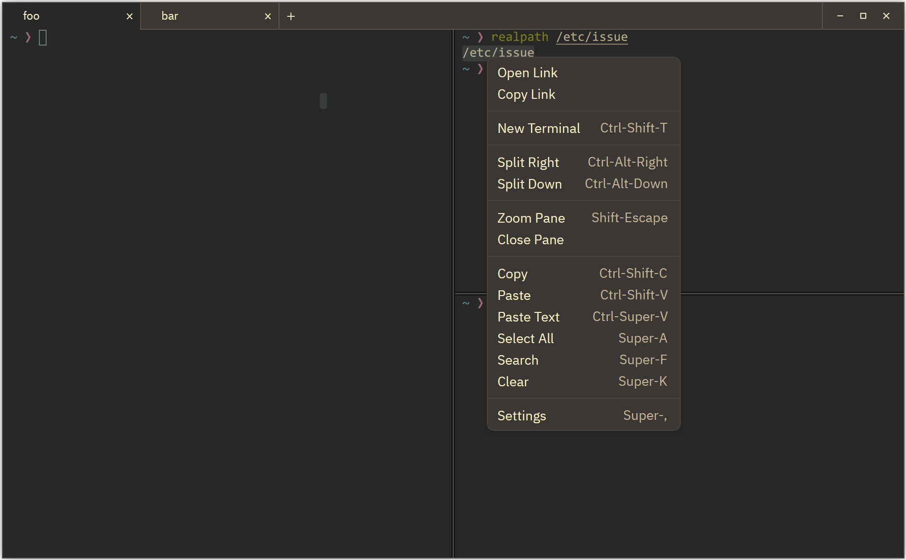

# ZedTerm

**English** | [简体中文](README.zh-CN.md)

ZedTerm is a standalone terminal application forked from [Zed](https://github.com/zed-industries/zed). It uses [GPUI Fast](https://github.com/longbridge/gpui-fast) with its own UI, theme, settings, and terminal implementation.

The fork has since diverged and does not track upstream, so a fix here is free to leave Zed's behavior behind. Formats users share with a Zed installation — `keymap.json`, the themes and extensions layout, the data directory — stay compatible on purpose. See [`.rules`](.rules) for what this means when changing code.

macOS 12 Monterey and later are supported. Linux builds and deb packaging are also supported.



## Features

- PTY and shell support with Alacritty terminal parsing
- Scrolling, search, selection, clipboard, and bell notifications
- Multiple windows, tabs, split panes, and moving tabs between windows
- Pane zoom, focus switching, and tab reordering
- URL, OSC 8, and path link support
- File uploads and downloads via [trzsz](https://trzsz.github.io/) and ZMODEM
- Terminal settings, keymap editing, theme extension management, and file manager integration
- English and Simplified Chinese interface. Choose **Display language** under **Settings → Terminal → Appearance** and save to switch without restarting.

See the [FAQ](docs/FAQ.md) for common questions and shell configuration tips.

## Project Structure

- `crates/terminal_core` — Terminal state, PTY handling, parsing, scrolling, and search
- `crates/terminal_app` — Application startup, windows, tabs, panes, settings, and rendering
- `crates/ui`, `crates/theme`, `crates/settings`, `crates/fs`, `crates/paths`, ... — infrastructure
  inherited from Zed. Prefer the two crates above when behavior is specific to this app, and change
  a shared crate only when the change belongs there.
- The GPUI core, macros, and platform backends use `gpui-fast` `0.1.19`. The HTTP client and
  refinement traits use the matching `gpui-pre` support crates at `0.3.14`.

See [`docs/TODO.md`](docs/TODO.md) for current work, planned features, and unsupported items. [`docs/PLAN.md`](docs/PLAN.md) and [`docs/GAPS.md`](docs/GAPS.md) contain archived project context.

## Development

Run commands from the repository root:

```bash
# Check the application
cargo check --locked -p terminal_app

# Run a development instance with a separate data directory
cargo run --locked -p terminal_app --bin terminal-app -- --user-data-dir /tmp/zedterm-dev

# Run the tests of every crate you touched
cargo test --locked -p terminal_app --lib
cargo test --locked -p terminal_core --lib
cargo test --locked -p settings --lib

# Check formatting and lints
cargo fmt --all -- --check
cargo clippy --locked -p terminal_app --all-targets -- --deny warnings
```

ZedTerm allows one process per data directory. Without `--user-data-dir`, a running
ZedTerm opens a new window and the newly built process exits successfully. That
window belongs to the existing process and does not run your newly compiled code.
Close the previous development instance before rerunning with the same directory.
See the [FAQ](docs/FAQ.md#why-does-cargo-run-exit-immediately-when-launched-inside-zedterm)
for details.

For code changes, also run `git diff --check`. Changes affecting interaction behavior should be smoke-tested on macOS.

Framework upgrades also require `cargo check --locked --workspace --all-targets`,
`cargo test --locked --workspace --all-targets`, and
`cargo clippy --locked --workspace --all-targets -- --deny warnings`.
Keep `font-kit`, `wayland`, and `x11` enabled on the GPUI core and platform dependencies to
build both Linux backends. GPUI property tests use the same `proptest` version as the framework.

Build releases with `cargo build --locked --release -p terminal_app --bin terminal-app`.
Use `scripts/package-linux-deb.sh` or `scripts/package-macos-dmg.sh` to package the resulting
binary. The default macOS build uses the Xcode Metal tools to embed precompiled shaders.
For local builds and tests with only the Command Line Tools, pass
`--features gpui_platform/runtime_shaders` to Cargo.

## License

ZedTerm inherits its licenses from Zed: GPL-3.0 ([`LICENSE-GPL`](LICENSE-GPL)) and Apache-2.0 ([`LICENSE-APACHE`](LICENSE-APACHE), copyright Zed Industries, Inc.).
GPUI Fast and the GPUI support crates use Apache-2.0 and retain Zed Industries' attribution.
Bundled fonts, icons, and themes retain the license and attribution files under `assets/`.
