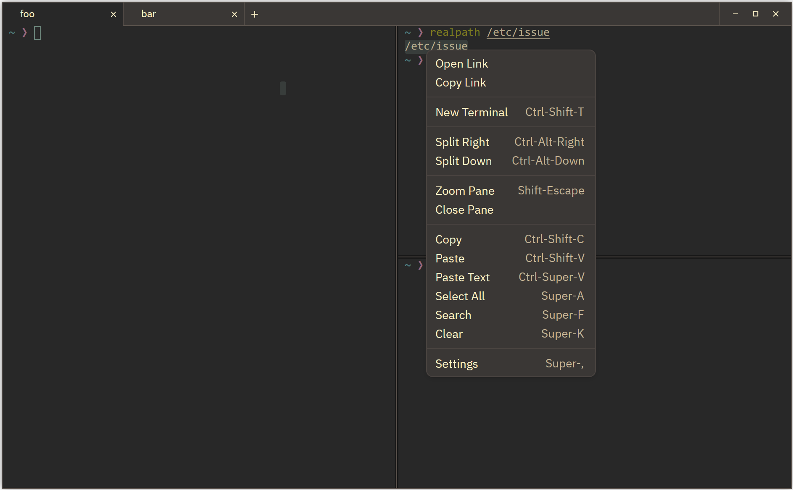

# ZedTerm

**English** | [简体中文](README.zh-CN.md)

ZedTerm is a standalone terminal application forked from [Zed](https://github.com/zed-industries/zed). It uses the published `gpui-pre` framework snapshots and retains its own UI, theme, settings, and terminal implementation without depending on editor features.

The fork has since diverged and does not track upstream, so a fix here is free to leave Zed's behavior behind. Formats users share with a Zed installation — `keymap.json`, the themes and extensions layout, the data directory — stay compatible on purpose. See [`.rules`](.rules) for what this means when changing code.

macOS is the primary platform. Linux builds and deb packaging are also supported.



## Features

- PTY and shell support with Alacritty terminal parsing
- Scrolling, search, selection, clipboard, and bell notifications
- Multiple windows, tabs, split panes, and moving tabs between windows
- Pane zoom, focus switching, and tab reordering
- URL, OSC 8, and path link support
- Terminal settings, keymap editing, theme extension management, and file manager integration

## Project Structure

- `crates/terminal_core` — Terminal state, PTY handling, parsing, scrolling, and search
- `crates/terminal_app` — Application startup, windows, tabs, panes, settings, and rendering
- `crates/ui`, `crates/theme`, `crates/settings`, `crates/fs`, `crates/paths`, ... — infrastructure
  inherited from Zed. Prefer the two crates above when behavior is specific to this app, and change
  a shared crate only when the change belongs there.
- GPUI core, macros, platform backends, HTTP interfaces, and refinement traits come from the
  `gpui-pre` family, pinned to `=0.3.1` in `Cargo.toml` and resolved in `Cargo.lock`. Local
  `gpui_util` and `gpui_shared_string` remain for independent support-library users.

See [`docs/TODO.md`](docs/TODO.md) for current work, planned features, and unsupported items. [`docs/PLAN.md`](docs/PLAN.md) and [`docs/GAPS.md`](docs/GAPS.md) contain archived project context.

## Development

Run commands from the repository root:

```bash
# Check the application
cargo check --locked -p terminal_app

# Run the application
cargo run --locked -p terminal_app --bin terminal-app

# Run the tests of every crate you touched
cargo test --locked -p terminal_app --lib
cargo test --locked -p terminal_core --lib
cargo test --locked -p settings --lib

# Check formatting and lints
cargo fmt --all -- --check
cargo clippy --locked -p terminal_app --all-targets -- --deny warnings
```

For code changes, also run `git diff --check`. Changes affecting interaction behavior should be smoke-tested on macOS.

Framework upgrades also require `cargo check --locked --workspace --all-targets`,
`cargo test --locked --workspace --all-targets`, and
`cargo clippy --locked --workspace --all-targets -- --deny warnings`.
Keep `font-kit`, `wayland`, and `x11` enabled on both the core and platform dependencies;
core features alone do not select the platform backends. The macro-only `inspector` feature and
the shared proptest patch work around snapshot/test-macro defects documented in
[`docs/GPUI_PRE_MIGRATION.md`](docs/GPUI_PRE_MIGRATION.md).

Build releases with `cargo build --locked --release -p terminal_app --bin terminal-app`.
Use `scripts/package-linux-deb.sh` or `scripts/package-macos-dmg.sh` to package the resulting
binary. macOS builds still require the Xcode Metal tools; the external Apple backend embeds
its compiled shaders, so no local GPUI checkout or additional shader resource copying is needed.

## License

ZedTerm inherits its licenses from Zed: GPL-3.0 ([`LICENSE-GPL`](LICENSE-GPL)) and Apache-2.0 ([`LICENSE-APACHE`](LICENSE-APACHE), copyright Zed Industries, Inc.).
The published `gpui-pre` family is Apache-2.0 licensed and retains Zed Industries' attribution.
Bundled fonts, icons, and themes retain the license and attribution files under `assets/`.
